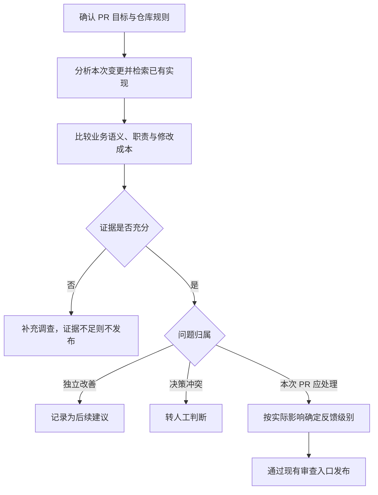

# Looper Reviewer 可维护性审查方案与评估指标

## 一、方案概述

**在现有 Reviewer 中补充可维护性审查方法，识别 PR 引入的重复逻辑、职责混杂、未复用已有能力及不必要的设计复杂度。**

首阶段通过自定义 Skill 试点，不新增 Agent、调度流程、数据库字段或合并门禁。Skill 作为审查方法说明，与内置正确性审查共同执行。

本方案采用已确认的**方案 A**，遵循以下原则：

- **范围约束**：仅将本次 PR 应处理的问题发布为审查反馈。独立重构与无关历史问题保留为后续建议，不要求 Fixer 自动处理。
- **证据要求**：每条反馈必须包含具体位置、语义或职责分析、影响、范围依据及最小修改建议。
- **影响分级**：普通维护性问题不阻塞合并；存在真实缺陷或违反强制规则时，按实际影响确定严重程度。
- **最小改动**：优先复用已有能力或删除多余层次，不以减少行数、增加抽象为目标。

预期收益是降低规则分叉、重复维护和修改验证成本，而非单纯提高代码复用率。

**当前状态：方案设计阶段。尚未实现或启用新 Skill，未修改 Spark。**

## 二、审查范围

| 审查维度 | 识别目标 | 排除条件 |
|---|---|---|
| 逻辑重复 | 同一业务规则存在多份实现，且需要同步维护 | 外观相似但权限、事务、错误处理或业务语义不同 |
| 已有能力复用 | 新实现与仓库内适用的函数、组件或服务重叠 | 复用会改变行为、破坏边界或引入不合理依赖 |
| 职责划分 | 函数或组件承担多个独立职责，导致理解、修改或测试困难 | 职责单一的长声明、规则表、顺序协议或合理展开的测试 |
| 设计复杂度 | 可在保持行为的前提下删除的状态、分支、包装或转发层 | 相关结构承担必要的权限、兼容、重试或资源管理职责 |
| 抽象边界 | 应共享的不变量分散实现，或不同业务被强行统一 | 仅凭重复次数、实现数量或代码长度判断抽象是否必要 |
| 测试可维护性 | 重复准备逻辑，或参数化导致场景、断言与失败原因不清晰 | 为减少测试行数而牺牲独立场景与定位能力 |

行数、相似度和分支数仅作为调查线索，不单独构成问题依据。本阶段不设置函数长度、重复次数或复杂度的强制阈值，也不引入新的静态分析工具链。

## 三、审查方法与论证要求

### 3.1 审查流程



### 3.2 论证要求

以下要求用于判断反馈是否具有充分依据，不转换为模型评分或新增输出字段。

| 论证项 | 要求 |
|---|---|
| 具体位置 | 标明本次变更位置，以及相关重复实现或已有能力的文件、符号 |
| 语义与职责 | 说明共同业务规则或独立职责边界，不仅比较文本相似度 |
| 影响分析 | 指明违反的规则，或具体的同步维护、测试与修复成本 |
| 范围依据 | 关联 PR 目标、Spec、仓库规则或本次引入的回归 |
| 反例检查 | 核对权限、事务、错误、平台和生命周期差异，排除不适用的复用建议 |
| 最小方案 | 优先复用、合并或删除，说明行为、依赖与兼容性影响 |

仅包含“函数过长”“抽象不足”或“建议优化”等判断，不满足发布要求。未检索到可复用能力，不等于能够证明仓库不存在相关实现；审查结论不得夸大实际调查范围。

### 3.3 首次审查与复审

- **首次审查**：覆盖 PR 范围内的全部变更，并检索必要的已有实现、调用方和测试。可维护性检查不得替代或削弱原有正确性审查。
- **修复后复审**：检查既有问题、新提交及直接受影响的代码，不重新扩展为未变化旧代码的重构审计。

反馈仅按共同根因去重。独立问题分别报告，不因评论数量或篇幅限制省略已证实的问题。

## 四、问题分类与发布规则

### 4.1 沿用现有处置机制

| 问题类型 | 处置分类 | PR 发布方式 | 合并影响 |
|---|---|---|---|
| 本次 PR 引入真实缺陷、破坏必要约定或违反强制规则 | `must_fix`，严重程度按证据确定 | 现有受控提交入口 | 可阻塞，须有具体影响依据 |
| 本次 PR 应处理、但不影响安全合并的维护性问题 | `must_fix` + `non_blocking` | COMMENT | 不阻塞 |
| 独立重构、无关历史问题或未来扩展建议 | `follow_up` | 不发布，仅保留结构化结果 | 无 |
| 需求意图或设计决策存在冲突 | `needs_human` | 不发布为修改请求 | 沿用现有人工处理流程 |
| 无法建立充分证据 | 继续调查；仍不成立则不发布 | 不发布 | 无 |

`must_fix` 表示现有系统中的“本次应处理”分类，并不等同于阻塞合并。P0–P3 优先级、严重程度和处置分类保持现有语义，不新增评分字段。

Fixer 仍根据仓库规则和 PR 意图独立评估反馈。Reviewer 的抽象建议不自动成为扩大实现范围的依据。

### 4.2 反馈示例

以下为假设示例，不代表真实 PR 的审查结论。

**符合要求：**

> **[P2] 复用现有候选人过滤条件构造器**
>
> 新增导出接口重复实现了 `buildCandidateFilter` 中的轮次和反馈条件，而 Spec 要求导出与列表保持相同筛选语义。两份实现独立维护，后续规则变更可能导致入口行为分叉。建议复用现有构造器，保留导出特有的分页逻辑，并补充对应条件组合的测试。

**不符合要求：**

> 函数超过 100 行，建议增加策略模式，提高可扩展性。

该意见缺少职责分析、实际影响和范围依据，且未说明新增抽象的必要性与成本。

## 五、接入方案与设计权衡

### 5.1 项目级 Skill

建议在试点业务仓库维护：

```text
.agents/skills/maintainability-review/SKILL.md
```

也可使用运行用户的 `~/.agents/skills/`。维护位置及首批启用项目在实施前确认，不默认影响全部仓库。

在项目配置的 `roles` 下增加：

```json
{
  "reviewer": {
    "skills": {
      "mode": "extend",
      "required": ["maintainability-review"],
      "optional": []
    }
  }
}
```

`extend` 保留内置 `looper-review` 并追加新方法；`required` 要求文件存在且有效，否则审查失败。实施前需核对部署版本对相关配置的支持情况。

### 5.2 权威与边界

**Agent 的结构化输出是审查结论的来源，仓库规则与 PR 意图是判断依据。** 基础设施信号仅用于执行状态和目标漂移检测，不替代语义判断，不通过新增评分器裁决问题是否成立。

Skill 提供行为指导，但不能保证 Agent 完整执行所有调查步骤。实际质量必须通过样本评估确认，不能以 Prompt 包含 Skill 路径作为效果证明。

### 5.3 方案成本与替代方案

优先复用现有机制，不增加 Reviewer 角色、模型调用、状态字段或发布通道。

更简单的替代是直接使用项目现有 Reviewer instructions 承载简短规则；若已能满足目标，则无需独立 Skill。独立 Skill 的价值在于集中维护详细方法和正反例，并支持跨项目复用。

主要成本与风险包括：

- 增加阅读、检索耗时及 Token 消耗。
- 增加规则和样例维护工作。
- 存在误报、检索不完整及与基础规则重复的风险。

退出试点时移除项目的新 Skill 选择项，保留基础审查。若收益不足，优先缩减规则或关闭，不继续叠加 Agent、评分字段或确认流程。

## 六、验证与效果评估

验证分为两层：**接入机制与边界验证、模型审查效果评估**。前者验证配置和发布行为，后者验证实际审查质量，两者不可互相替代。

### 6.1 接入与边界验证

| 验证场景 | 预期结果 |
|---|---|
| 基础 Skill 与新 Skill 同时启用 | Prompt 包含两者路径，基础审查要求保留 |
| required Skill 缺失或名称错误 | 沿用现有解析失败行为，不静默跳过 |
| 同时包含本次问题、独立改善和人工决策项 | 仅发布符合现有规则的本次问题 |
| 普通维护性反馈 | 不错误升级为阻塞性审查 |
| 修复后复审 | 保持既有问题与增量范围，不扩展为历史代码清理 |

复用或补充现有 Skill 解析、Prompt 和发布合同测试。本方案不改变鉴权、线程修改或限流行为，不因此扩展为生产远端写操作测试。

### 6.2 对照评估方法

首轮建议至少准备 **20 个固定样本，包括 10 个正例和 10 个反例**，覆盖第二节的审查维度。维护者预先标注独立问题、PR 范围及严重程度，并裁决分歧。

对同一份 base/head 代码，使用相同 Agent、模型、执行配置和审查范围，分别运行：

- **对照组**：仅使用基础审查 Skill。
- **实验组**：基础 Skill + 可维护性 Skill。

在隔离样本中收集结构化结果，不向真实 PR 自动发布。记录代码版本、Skill 修订和执行设置；失败及数据缺失样本单独报告，不从结果中隐去。

### 6.3 评估指标与建议目标

下列数值为**待评审的试点目标，不是生产合并门禁**。

| 指标 | 定义 | 建议首轮目标 |
|---|---|---|
| 准确率 | 人工确认成立且处置正确的拟发布维护性问题数 / 全部拟发布维护性问题数 | ≥90%；无候选时记 N/A |
| 检出率 | 正确发现的标注独立问题数 / 全部标注独立问题数 | ≥80%；按根因匹配，不按评论条数统计 |
| 论证完整率 | 满足第三节六项论证要求的拟发布问题数 / 全部拟发布维护性问题数 | 100%；人工核查内容，不仅检查字段存在性 |
| 范围越界数 | 独立改善被分类为本次应处理问题的数量 | 固定反例中 0 次 |
| 错误阻塞数 | 普通风格或可选简化被判定为阻塞的问题数 | 固定反例中 0 次 |
| 不当抽象建议数 | 忽略已知语义差异，或建议引入无必要概念的问题数 | 固定反例中 0 次 |
| 基础审查回归数 | 对照组正确识别、实验组遗漏的既有正确性问题数 | 固定回归样本中 0 次；同时报告两组整体表现 |
| 执行开销 | 同样本耗时与 Token 消耗的配对变化 | 报告中位数和 P90，首轮不设硬阈值 |
| 建议可执行性 | 可在 PR 范围内保持行为地实施的建议数 / 已确认成立的维护性建议数 | 报告比例及不可执行原因 |

Token 数据不可获取时明确标记缺失，不以输出字符数替代。无输出、执行失败或缺少有效标注的情况单列，不按成功样本处理。

20 个样本仅用于初步验证，不足以证明线上准确率稳定达到目标。推广前需扩大样本并检查多次执行的波动，同时评估有效问题增益、误报、基础审查回归与执行成本。

## 七、实施计划与发布边界

1. **方案评审**：确认试点项目、Skill 维护位置、标注负责人及评估目标。
2. **方法实现**：编写 Skill 与正反例，验证现有选择及 Prompt 接入机制。
3. **效果验证**：执行固定样本对照，评估误报、漏报、范围控制与资源开销。
4. **受控试点**：评估结果经确认后，另行授权启用项目配置，不直接全量推广。

Skill 位于业务仓库或用户目录时，通常无需重新构建 Looper；若后续决定内置该方法，则需构建并发布新二进制。上述实现、评估与部署均尚未执行。

## 附：实现依据

- 基础审查方法：`internal/reviewer/reviewskills/builtin/SKILL.md`。
- 证据与评论标准：该目录下的 `references/evidence.md`、`comment-quality.md`、`implementation-rubric.md`。
- Skill 配置：`docs/configuration.md` 的 Reviewer skills 章节。
- Prompt、问题分类与发布合同：`internal/reviewer/runner.go` 中的 `buildReviewPromptWithInstructions()`。

本文依据用户提出的重复代码、长代码及抽象问题，以及已确认的方案 A 编写。后续实现、测试、构建和评估结果在本文中持续补充，不新增独立评分系统或状态账本。
