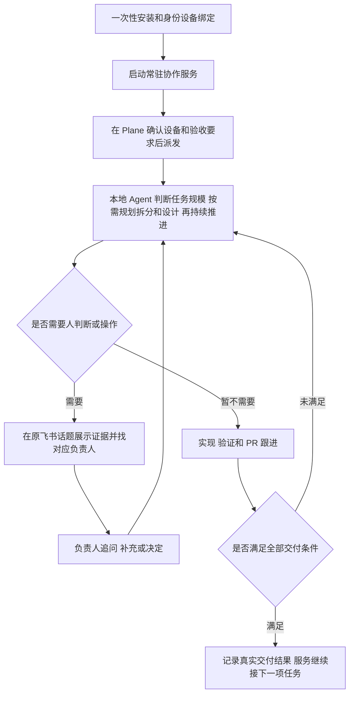

# Looper 协作子命令实施计划

更新日期：2026-11-17。当前独立入口已直接集成 feishu-codex-bridge；真实 Plane 派发的 LOOP-9 已完成并保留可点击来源编号，Module 任务 LOOP-10 自动建群、执行中宿主崩溃后续接原会话，创建 sandbox PR #2699 并进入观察。已补验用户授权代发的 @bot 消息回执和原会话续跑，真实测试 review 自动唤醒、修改并推送同一 PR。已补验五任务真实并发／排队／自动接续，以及 Agent 自主选人、bot 邀请并确认入群、原生 @ 的实例。第一阶段仍未通过：运行中追加消息、CI／冲突／最终合并及同事接入尚未完整验收。逐项最新状态、历史问题与人工补位见[本次端到端测试记录](E2E-collab-2026-11-16.zh-CN.md)；下方早期实施记录保留历史方案，不代表当前运行时。

目标是在 Looper 仓库内提供 `looper collab`，让同事完成一次安装和身份绑定后，持续从 Plane 接任务，在飞书沟通、决策和验收，由本地 Agent 推进到约定的交付终点。

同事联调入口：[本地运行端到端测试指南](collab-local-e2e.zh-CN.md)，包含本机配置、设备连接、私测群交接、PR 验收、日志与本地 Plane 启动步骤。

`looper collab start` 启动每台电脑上的常驻服务，只需启动一次；每个任务通过 Plane 显式派发。开机自启后，同事日常无需打开终端。分配负责人只表达归属，不自动开工。

## 日常使用流程

当前已实现的命令如下。开发副本先执行 `go build -o dist/looper ./cmd/looper`，使用 `dist/looper` 调用；已安装的旧版 `looper` 不会自动获得这些命令。

| 命令 | 用途 |
| --- | --- |
| `looper collab start` | 启动常驻协作服务，与任务数量无关 |
| `looper collab status` | 查看协作进程和任务状态；不代表已经连接 Plane |
| `looper collab run --project <id> --prompt-file <path 或 ->` | 从终端显式派单；project 为接单上下文，不绑定单一仓库；也支持 `--issue <序号>`、`--module <name>`，不是 Plane 设备授权派发的替代品 |
| `looper collab logs` | 查看宿主日志；按任务查看完整执行日志仍待接入 |
| `looper collab stop` | 取消生产任务并排空子进程，等待服务释放运行锁 |

身份绑定优先复用已有登录和 Plane 设备连接能力；服务停止与开机自启接入 Looper 既有生命周期能力，在提供自启前验证可正常停用。并发与排队复用现有执行队列，同一任务不能由两个入口重复接手。

## 模块边界

最终在 Looper 同一仓库、同一安装和发版中维护协作功能。当前先在 `looper-collab` 工作副本实现和验证，再将整理后的改动集成回原 Looper；该副本是过渡开发位置。

| 边界 | 负责什么 | 复用与拆分要求 |
| --- | --- | --- |
| 命令和启动 | 配置、启动、状态与日志入口 | 在现有 CLI 注册 `collab`；独立装配协作所需服务 |
| 协作模块 | 任务推进、飞书群与话题、找人、回复续跑、交付与 PR 跟进 | 沿用任务记录与 checkpoint，保持一个任务推进负责方 |
| 共用基础能力 | Agent 启动与原生会话续跑、Git/worktree、存储、队列、设备身份与连接、PR 读取与通知传输 | 从现有实现提取真正共用的能力，保留单份实现和原有恢复语义 |
| 外部接入 | Plane 派单和状态、飞书消息、代码托管平台 | 把外部数据转换为任务输入；平台专用类型留在对应接入模块 |

协作核心接收任务目标、已有上下文和验收要求，将本机可用仓库及用途提供给 Agent。仓库和需参与的人可以由 Agent 调查确定，不要求派单人预先填全。已有 Worker 与通知代码需要先拆开依赖，才能复用到独立入口；不能直接把完整 Runtime 搬进来。

独立性以以下条件验收：

- 仅启动协作入口即可接单和推进，不要求另外手工启动 Friday、完整 `looperd` 或独立 Planner／Reviewer／Fixer 进程。设备连接所需的 loopernet 能力可由协作入口装配；不以删掉规划、身份认证或在线状态来满足独立性。
- 协作核心不依赖完整 Runtime 的装配，不强制走 Planner／Reviewer／Fixer 的固定多角色流水线；必要的平台调用留在适配代码中，复用既有签名、派发、领取及状态接口。
- 只校验本路径实际使用的配置，不因未配置其他角色或无关服务而拒绝启动。
- 运行数据、消息消费与任务领取范围和原 daemon 隔离；复用存储与队列代码，不复制一套实现。隔离方式在启动改造时明确，并验证两个实例不会接手同一项工作。
- 同一个 CLI 二进制继续包含其他命令，不影响上述运行与模块边界。

拆分优先删除无用装配和固定流程；不增加通用插件框架、第二套调度器、另一套任务状态机或新的证据账本。每次新增持久字段或校验都要说明实际解决的问题、权威来源和维护成本，遵循仓库 AGENTS.md。

### 保留规划和设备连接能力

本地 Agent 接手后先了解目标、实际代码和验收要求，再判断规模与风险。所有任务，包括小修复，都要先检查问题原因、调用方及模块／仓库影响面、兼容性、数据和安全风险，并确定验证及回归方式，简短说明判断依据；不能只根据标题认定是小任务。确认范围小且风险清楚后可以实现，不强制另写设计文档；涉及多个模块或需要协调步骤的任务先列计划，必要时拆成可验收的子任务；涉及架构、数据迁移、协议兼容或重要方案取舍的改动先准备技术设计。发现范围扩大时重新判断，不以最初的分类强行推进。以上属于同一个 Agent 按需采用的工作方式，不要求另起 Planner 进程，也不要求每项任务都写设计文档。已将上述要求接入原 Worker 的任务提示词；真实 Agent 是否按要求执行仍须在任务验收中核对，提示词接入不能冒充行为已验证。

Agent 能自行查明和决定的事情继续推进；需求含糊、方向取舍、风险授权或人工验收需要人判断时，在原飞书话题提供易理解的方案和证据，找对应的产品、设计、研发或 QA 负责人。技术设计及拆分本身不自动构成人工审批关卡。

设备身份、Plane 成员与设备绑定、连接认证和在线状态是接单必需的能力，继续保留。优先复用 loopernet 及现有 Plane 绑定、密钥、签名会话和在线状态实现，检查能否由 `looper collab start` 只启动所需部分。独立入口指不用另外启动完整 Looper，不指省略认证，也不为避开 loopernet 依赖而另造设备身份或认证协议。若无法局部复用，先说明具体耦合及拆分方案，再决定改动范围；在联调前不宣称 Plane 已能识别或派发到该入口。

## 协作和交付规则

一个需求根 item 或明确选择的 Module 对应一个飞书群，每个子 item 保持一个固定 thread。只在首次派发时按需创建或关联群，推进中邀请真正需要的人。主卡更新原消息，保留可点击的 Plane 编号、当前进展、交付入口，以及当前等谁处理什么。

产品、设计、研发和 QA 均指人的职责。Agent 根据 item／Module 已有信息、团队上下文和实际问题决定找谁，不要求完整填写角色，也不设固定角色校验；不确定时询问 Looper owner。建群时邀请 owner，推进中按需邀请其他同学；先确认入群再 @。普通实现由 Agent 自行推进，只有缺少上下文、方向判断、权限、人工验收或人工操作时才进入 HITL。

按问题分工：业务规则、预期行为、范围优先级及新旧需求冲突找产品；视觉与交互体验找设计；技术风险、架构兼容及工程取舍按需找研发；复现、功能回归与测试结论找 QA。普通技术实现继续由 Agent 自主推进。owner 帮助补上下文、找人、协调权限，不默认替代各职责；只有找不到合适的人、职责有分歧或需其权限时再找 owner。一个人可承担多种职责，包括明确承担产品职责的 owner；不要求固定人员表或按顺序审批。

派发执行负责人和工单 assignees 不是同一信息，派给本机 Looper 后工单经办字段可能仍保留其他人。经办人、创建人和历史参与者只提供找人线索，不足以证明 QA／产品职责或签字权限；不能因此把执行责任推回原经办人。可以基于明确分工、相关经验、实际风险或已有 review 规则请其协作，联系时简短说明依据和具体请求；不凭原经办身份增加必需审批，不把可选建议变成阻塞。

Plane 工单的业务状态也由 Agent 按实际工作维护，不能只更新 Looper 运行状态和时间轴。接手及续跑时读取当前工单和项目真实状态列表，在实际设计／开发、提测、返工、验收及发布阶段用已有 Plane CLI/API 更新并读回；不硬编码状态 UUID 或名称，不给所有项目强套相同流程。提测须有准确可验版本、自测证据和发给 QA 的实际请求，发出请求不能冒充测试通过；结束模型回合、创建 PR、CI 转绿或单个 PR 合并不等于工单已完成。尊重人的暂停／取消及后续阶段，不无故回退。现有接口要求证据时补真实材料，权限或含义不明时找人协助，状态更新失败仍继续其他工作；不加宿主状态机或新的审批门禁。

呈现规则由渲染器与提示词共同落实：左侧状态和可点击 Plane 编号使用同字号的原生标签，任务标题放右侧，最右侧用小灰标签标明「某某的 Looper」；归属信息从已有人员目录读取，不占正文、不默认展示机器名，也不为每次状态更新 @owner。主卡保持精简并更新原消息。Agent 回答保留 Markdown 的段落、列表和链接；技术验证与单条执行过程默认折叠，问题、编号选项及影响决策的风险可见。提示词要求结论先行、简短说明，不把工具流水混入最终回答；“@bot 验收通过”默认针对当前任务交付，不再反复确认相同范围。当前直接集成 [feishu-codex-bridge](https://github.com/modelzen/feishu-codex-bridge) 的运行时，Looper 保留任务主卡、Plane 派发及 PR 观察；不再逐项复制其对话卡片。

Plane 派发携带实际分组关系：优先父需求树，同一父需求下的任务即使分属多个 Module 也共用需求群，各 item 独立话题；多层父子关系使用最上层需求范围。单独的明确需求类型建立需求群；没有父需求且不是需求本身时才按 Module 分组，多 Module 取最早关联项；孤立 bug／优化进入默认群。Plane 目前明确需求类型指 is_epic 或内置“需求”；自定义类型不从标题推断。分组 key、群和话题写入已有任务记录，后续关系变动不搬迁已进行的话题；新优先级不自动合并已经存在的 Module 群。真实自动邀请仍需飞书应用的成员权限及目标用户可用范围，不因邀请失败阻断代码执行。

问题放在原话题中，展示必要证据和编号选项，负责人通过 @bot 自然回复。普通人与人聊天不要求 Agent 每条响应；回复、追问、否定和纠正都回到对应任务，不能把旧验收回复用于回答新问题。执行中插话如何排队及何时打断，应在接入该能力时明确，不在首版宣传未实现的即时打断。

每项任务都要提供适合验收的交付：简单改动给截图或可复现结果；交互给可操作预览及必要录屏；客户端能力给可运行构建或安装包。交付对应实际仓库和版本，验收人能够访问，附简短步骤、预期结果、已验证与未覆盖范围。私测本机 localhost 的可达性不能当作同事已能访问。

Agent 主动发起验收，不以自测通过、创建 PR 或写一句“待验收”作为收尾。结合已有分工、任务参与者、Module 上下文和人员目录找合适的人；角色为空不构成停点，有合理线索就直接联系相关同学协助复现或回归，不必先请 owner 批准验收人。业务判断先找相关产品，体验判断找相关设计；确实找不到合适的人、职责有分歧或需 owner 协调权限时再问 owner。先邀请并确认入群，再 @ 提出具体请求；首屏展示效果、准确版本和简短步骤，技术资料归档 Plane，不把资料 ZIP 当作默认验收入口或修复安装包。等人期间继续独立可做的 CI、review 和修复；收到问题后返工并交付新版本。截图外观、功能自测、真人验收、合并和发布分别如实说明。

后续待建设（本阶段先记录，不立即实现）：交付入口不可用时由 Agent 主动尝试替代呈现，例如演示视频、关键步骤截图、飞书附件，或用飞书文档组织说明、图片、视频及 HTML 附件／预览链接。一次预览部署失败不直接判成交付受阻。降级形式要足以让人判断当前问题，并说明不能覆盖的交互；截图或视频不冒充可操作验收环境。飞书文档能否直接运行内嵌 HTML 尚未核实，不能预设具备该能力。

同一 Plane project 可以包含 OpenDesign 与 OpenMotion 的任务。Agent 根据任务、仓库说明和实际代码判断涉及哪些仓库，不能仅凭 project 名称选仓库；调查后仍有歧义或需要产品取舍时再问人。允许同一任务跨仓处理，按需保留各仓工作树与 PR 关联。话题关联任务与会话，不永久绑定单一仓库，也不要求人先选仓库才准许 Agent 开始调查。

代码任务持续处理 PR review、CI 失败、冲突和合并队列。等待外部结果时交给后台观察，状态不变不反复调用模型；有实际变化后续接原任务会话。测试通过、人工验收回复、模型回合结束和创建 PR 都不构成任务终点。

最终合并遵循仓库权限与规则；当前试点由负责人合并。需要发布或目标环境验收的任务，还须完成相应交付条件。非代码任务按其真实产物和验收要求完成。人反馈未修好时继续修复，并复用仍与当前代码、环境匹配的验证及真实验收证据。

## 实施阶段和通过条件

### 2026-11-16 实施记录

早期实现位于 `looper-collab` 开发副本。当前已接回 `looper-integrated` 的 `feat/looper-collab-standalone`，对应 Looper PR #696；Plane 配套改动位于 `plane-looper-collab`。本轮联调修复仍在本地，尚未提交或发布。

已完成：

- `internal/collab` 独立装配已有 Worker、SQLite 队列、执行器、Git/worktree、飞书通知与答复轮询、PR 观察器，没有调用 `Runtime.Start` 或启动完整调度器。
- 执行进程、操作租约及任务领取／落库收尾移到 `internal/executionhost`；任务平台、执行器适配及 PR 观察器移到 `internal/workerhost`，原 daemon 改用共享实现。停止撞上领取或执行时，沿用原有取消后收尾逻辑；持久化失败保留所有权并停止接单。没有复制第二套执行器或 PR 状态机。
- 每台机器启动一次，默认后台常驻；`--foreground` 便于调试。控制入口是仅本用户可访问的 Unix socket，不向网络公开执行接口。
- 数据默认位于原 SQLite 目录旁的 `collab/` 子目录，可用 `--state-dir` 指定；沿用 Looper 表和 migration，不读取原 daemon／Friday 队列。运行锁防止同一目录启动两份宿主。
- 派单必须同时指定配置项目和匹配的代码仓库；任务记录与队列原子创建，拒绝同一活动目标重复派发。没有根据标题推断仓库。
- 沿用原飞书主卡更新、编号选项和 @bot 答复续跑。协作宿主在 worker 入队时准备任务群：有 issue 或显式 `module` 的任务按稳定 key 复用／创建独立群；没有 item 归属的运行进入默认群。群 ID 写回 loop metadata，重启后继续使用原群。`hitl.feishu.inviteOpenIds` 和可选 `ownerOpenId` 只作为初始邀请名单，群内其他成员可以自然参与，不要求 Plane item 先填写完整角色。
- PR 保持观察直到真实合并／关闭；删除原来 25 次跟进后无声放弃的限制。相同外部信号不重复唤醒模型，合并仍由有权的人完成。

自动验证包含：同一宿主连续执行两个任务（真实 git/worktree/执行器，模型为本地测试替身）、执行中停止后排空子进程并完成领取收尾、重复宿主互斥、错误仓库拒绝、队列写入失败不留孤立任务，以及 CI 变化唤醒、超过 25 次仍跟进、全绿后继续等合并、真实合并状态才收尾的契约测试。自动测试中的 GitHub 和模型替身不算真实 PR 或真实人工验收。

本轮新增的接通能力：

- 每项任务的 Worker 提示词都要求先检查原因、调用方、共享模块／仓库、兼容性、数据及安全影响、验证和回归方案。按实际规模决定计划、拆分和技术设计，不根据标题判断“小修复”，不新增固定 Planner 进程。这是执行要求接线，不冒充真实 Agent 每项均遵循的评测结果。
- 协作宿主直接装配原 loopernet 客户端，复用设备身份、认证、心跳和漂移检查，仅发布 Worker 与明确的代码仓库能力。原 daemon 和协作宿主不能同时以同一身份发送心跳；复用 OS 文件锁防止两者覆盖在线能力。锁随宿主退出释放，无新增状态账本。
- 原 Plane 一次性设备绑定继续使用 CBOR／Ed25519 协议。`looper plane connect <地址> --code <一次性代码> --collab` 只完成绑定并通过签名 inbox 验证，随后执行一次 `looper collab start`；不自动启动完整 daemon。已经运行的协作宿主需要停止并重启以加载新配置。未加 `--collab` 的旧连接流程保留。
- Plane 改动位于独立工作树 `../plane-looper-collab`，分支 `feat/looper-collab-standalone`。设备发布的仓库清单按 Plane workspace／project 限定；当前实现派发前仍要求选仓库，这是现有实现限制，后续按最新约定调整为 Agent 自行判断、必要时问人。原 Planner 领取路径跳过 collab 派单。原项目管理员激活、人的职责配置及既有 strict/legacy item 分类规则仍保留。
- 协作宿主使用原签名 inbox／claim／transition，派单 ID 原子关联同一任务和队列。领取前过滤仓库；重复派单与终态重放不重新开工或覆盖 PR 目标。单个派单错误记录后继续处理其他任务，原重试机制处理暂时失败。
- HITL 保留原任务、会话和派单关联。PR 等待期间继续保持 running，真实合并才完成，关闭未合并记失败。停止沿用已持有进程的排空和停止门；不根据历史 PID 杀进程，晚到回复不能复活已终止任务。
- 异常恢复已从原 daemon 提取到共享 `executionhost.Recovery`，两个入口共用。可以恢复领取后尚未执行、无执行记录或已持久化退出的任务；不确定或仍存活但不属于当前宿主的执行证据，沿用 paused／manual_intervention 隔离该任务，其他任务可继续。不能据此宣传任意掉电现场都能无条件自动续跑。

本轮自动检查：`go test -p 2 ./...` 全部通过，Go vet／build、源码格式及 diff 检查通过；Plane 的 19 项绑定／签名派单／任务汇总契约测试、10 项目录／汇总单元测试通过，Web 工作区依赖构建、类型检查和所改 TS 文件 lint／格式检查通过。首次高并发 Go 全套中的两项原生恢复测试超时；单独复核和限制包并发的全套通过，未改其生产逻辑或放宽测试断言。记录见 `.tmp/collab-refactor/final-tests-5.log`，Plane 检查日志位于本机 `/tmp/looper-plane-*`。迁移 dry-run 另报 Account／PageComment 字段漂移，不属于本次 Looper 模型；新增 Looper migration 已在隔离数据库成功应用，未顺手生成无关 migration。

跨服务本地联调：启动隔离的原 loopernet 服务、原生 Plane API、独立 collab 宿主和本地 Git 远程，使用临时信任密钥，通过真实连接代码、挑战签名、绑定、inbox、claim、状态回写走到 completed。任务只有一个 loop、一个队列和一次模型执行；重复派发返回同一 dispatch。最初本地测试远程配置错误产生三次准备失败，修正远程后原任务自动重试成功，没有生成新任务。模型是确定性的测试子进程，不算真实 Agent／飞书验收／PR 合并／公司 SSO。空闲宿主经 SIGKILL 后重启，仍保留同一已完成任务且未再次调用模型。结果保存在忽略目录 `.tmp/collab-refactor/local-integration/acceptance-result.json`。

本机私测样例“独立入口私测 · 验收表达方式”已由真实 Codex 生成单文件 HTML 并在本机 Chrome 打开检查。独立宿主已在原私测群创建并更新同一张主卡，在原话题发出编号选项，当前为 `awaiting_human`，尚未收到本人的真实答复。此任务不推远程、不创建 PR，不能据此把第一阶段标成完成。测试现场和产物保留在忽略的 `.tmp/collab-refactor/` 下。

尚未完成：正式 Plane 环境部署与真实业务派发验收、同事接入与自启、按任务日志入口，以及真实业务任务的 PR 全流程验收。需求／Module 群关联已接入独立入口，但还需要在真实飞书租户验证建群、邀请和重启后的复用。首版暂时串行执行；没有接入其他 Agent 角色。沿用了配置加载与部分底层平台辅助包，依赖裁剪也尚未全部完成。

正常停机后可以重启，停在 HITL／PR 等待的记录保留。异常退出按上面的共享恢复规则处理；真实执行中机器掉电／遗留进程现场尚未验收。当前只在 macOS 验证 Unix socket 路径。

### 第一阶段 独立入口跑通一个真实任务

先整理 Worker、通知和启动依赖，接入子命令与常驻服务，复用既有任务记录、队列、执行和续跑能力。先在已授权的负责人和 bot 私测群验证，保持现有 Friday 活跃任务的执行权。

首个里程碑：只启动一次 `looper collab start`，通过 Plane 显式派发一项仓库已确定的真实任务，Agent 能交付可体验结果、接收真实回复、创建 PR 并持续跟进，直至按仓库规则完成最终收尾。整个任务不依赖 Friday 或完整 Looper daemon。测试后服务继续等待新任务。

通过条件包括：

1. Plane 能看到目标本机服务状态，派发后只执行一次；断线和重复派发不生成重复任务。
2. 任务消息落到私测群对应话题，主卡在原消息更新，交付入口对应真实版本。
3. 发生一次真实人工交接：明确提问、本人回复、原任务继续。普通聊天和历史回复不误触发。
4. 真实 PR 关联回原任务。CI／评审等待期间任务保持可推进；最终人工操作完成后核对真实结果。
5. 服务重启后既有记录、话题关联和等待状态保留，不重复提问或创建 PR。原生会话恢复范围以实际能力为准；服务重启与机器掉电、Agent 进程死亡分别验证和说明。

采用真实任务和真实人工答复验收；缺少原环境、尚未合并或仍需人工补位的步骤如实记录。首个任务只能证明已走到的路径。

### 第二阶段 验证异常路径并减少依赖

围绕第一阶段的同一推进链，补齐 CI 失败、新评审意见、冲突、PR 关闭未合并、队列阻塞、验收不通过、网络中断和重启恢复的回归覆盖。适合自动化的场景使用本地替身，必要路径再做受控联调，区分回归测试和真实外部验证。

检查依赖后删除协作路径仍残留的固定角色流程、重复推进逻辑和无关启动要求。通过条件是独立入口仍可走通，依赖范围确实缩小，原 Looper 受影响路径通过回归。拆分基础能力时，原入口和协作入口都调用同一份实现。

### 第三阶段 迁入 Friday 的有效成果

迁移需求／Module 群、跨执行的 item 话题、按需邀请、卡片表达、人的角色路由和 PR 跟进测试场景。优先移植规则、渲染和测试经验，按 Looper 原有执行与存储边界实现，避免复制 Friday Control 与 daemon 的整套执行循环。

逐项核对仍在 Friday 运行的任务、工作树、PR、真实回复和待答问题。对活跃任务明确选择原地收尾或移交，确保只有一个执行负责方后，再停用对应试跑链路。此后协作功能集中在 Looper 内维护。

通过条件是原交互和交付体验保留，同一个任务只由一条链路处理，文档和安装入口一致。现有私测试用不自动授权创建或通知正式团队群。

### 第四阶段 交付给同事使用

完成真实登录、Plane 成员与飞书账号关联、本机设备绑定、常驻生命周期，以及向 Agent 提供可用仓库及用途。飞书身份、Plane 项目权限和本机执行权限分别核对；是否复用公司 SSO 依据现有集成确定，本地 mock 登录不能作为完成证据。

接通任务所需的预览、截图、录屏或构建包共享方式，提供可发现的运行与任务进度入口。优先复用 Plane 列表、详情、设备状态及已有 CLI；团队 Dashboard 后建，不用群置顶全员总览替代进度入口。

交付评测先利用原任务记录保留目标、实际仓库与版本、验证证据、人工结论、返工原因及宿主补位步骤。区分已验收、未验收和验收失败；模型自称完成与 CI 全绿不作为业务通过。之后再建设跨任务的 Dashboard 和评测汇总。

通过条件：同事按文档独立完成安装和绑定，在 Plane 发起任务，在飞书完成沟通与验收；知道去哪里看进度、遇到问题如何停用服务，以及如何回看交付是否符合预期。

## 当前基线和下一项工作

### 2026-11-16：飞书交互改为直接集成 feishu-codex-bridge

根据最新体验反馈，停止继续在 Go 内逐项复刻卡片、文本流和排队交互。下一步优先让 [modelzen/feishu-codex-bridge](https://github.com/modelzen/feishu-codex-bridge) 整体承担飞书会话及 Agent 运行；Looper 保留 Plane 接单、设备连接、可用仓库上下文、任务记录和 PR 持续跟进。实际 worktree 由 Agent 按需准备。独立私测实例已启动固定版本的上游运行时，并完成不指定仓库的跨仓只读任务；原 Worker 的活跃任务仍归原宿主。Plane 和 PR 的完整新链路继续验证。

已阅读参考源码版本 `0.6.15`（MIT）。它已有文字与工具事件分别呈现、执行过程折叠、排队占位卡、逐轮卡片、运行中追加输入，以及原生会话恢复。其本地 CLI hooks 通道主要面向 owner 私聊的审批、提问和结束续聊，并非这套完整的群话题运行界面，不能将接上 hooks 当作整体集成完成。

接入范围为中等改造，主要集中在以下边界：

1. **外部派单入口。** 当前公开 npm 入口只导出日志与路径，Web API 为管理用途，没有现成的任务提交接口。先在隔离的上游源码副本添加小范围本地接口，调用它已有的 orchestrator，而不是伪造用户飞书消息或复制 renderer。具体协议通过最小接入实验确定，再固定上游版本及补丁，保留 MIT 版权信息。
2. **Agent 自行判断仓库。** 上游默认一个群对应一个初始 cwd，这只是进程起点，不将其解释为业务上的仓库限制。向 Agent 提供 OpenDesign、openmotion 等可用仓库的路径和用途，由它阅读代码、判断范围；不清楚时问人，允许一个任务涉及多个仓库。话题只关联任务和会话，不增加必填仓库或每话题单仓绑定。实际修改代码时按需复用 worktree 隔离并发改动，续跑保留已经使用的路径；图片和文件引用按其实际路径解析。接入实验先确认现有 bridge 的 cwd、会话与文件能力是否够用，再决定必要改动，不预先设计一套目录绑定机制。
3. **执行归属。** 利用 Looper 已有 `worker.AgentExecutor` 接口评估委托执行，使 bridge 成为新链路唯一的 Agent 会话管理者和飞书消息消费者。运行结果回到原任务，CI、review、冲突等新事件也交回同一会话。Looper 不再在该链路另外启动 Codex 或运行第二套 HITL 回复轮询。复用原 PR 观察能力；bridge 的单轮 `done` 不等于任务完成。
4. **协作约定。** 保留 Module／需求一群、子任务一话题、零散任务默认群；bot 身份发送、先邀请再 @。上游默认话题内免 @，本项目先显式关闭，保持人与人自然聊天、@bot 才交给 Agent。不设置不同人对应不同 Agent 会话的角色权限分层。找谁决策、何时需要设计和怎样表达证据，继续优先由提示词指导。

改造会新增 Node 运行时依赖，但用户入口仍为 `looper collab start`，由其管理 bridge 子进程；正常使用不要求手动启动第二项服务。第一步只在独立测试实例验证文字进度、折叠过程、排队及真实回复续跑，再接 Plane 与 PR。迁移活跃任务前必须明确原生会话接续方式；未实现前原任务继续归原宿主处理，不同时连接两个消息消费者。

验收沿用现有真实链路：Agent 能根据代码识别任务涉及的仓库，跨仓任务可在原话题推进，范围不清时向人提问，并发改动互不覆盖；真实 @bot 回复回到原任务；只读任务正常结束且不要求产生 PR；开发任务持续跟进真实 PR 状态。上游功能存在不代表我们的集成已经验收，也不保证模型在没有文字事件时自动产生解释；提示词仍要求在关键节点提供简短自然语言进展。

Looper 协作副本已有独立 `looper collab` 宿主，可从终端派单，沿用 Worker 私群 HITL、原卡更新、原生续跑及 PR 观察能力，无需启动 Friday 或完整 daemon。私测样例正在等待真实答复；这不等于 Plane 到真实 PR 的第一阶段已通过。

本地已接通 Plane 原设备授权及显式派发，并共享原异常退出恢复逻辑。接下来将两个仓库的改动交付到实际 Plane／Looper 试点环境，以仓库已确定的真实任务验证人工交接及 PR 持续跟进；仍需完成配置依赖裁剪和按任务日志。完成第一阶段后再迁移群关联和团队接入；Friday 的既有活跃任务继续由原链路处理。

### 人员目录（2026-11-17 确认）

先自动同步 Plane 项目成员和当前 bot 可见的飞书通讯录到协作工作目录的 `people.json`，由 Agent 按需读取、决定找谁，不明确则问 owner。不按邮箱或同名建立程序化关联，不要求每个 item 配齐产品／设计／研发／QA，不新增响应人门禁。SSO 向 Plane 传递现有飞书身份字段暂不纳入本次改动。

长期人员记忆暂缓，本次只提供可刷新目录，不增加跨任务人员记忆文件或自动记忆写入。

同步随 `looper collab start` 在后台运行，每 10 分钟刷新；`looper collab people --json` 可查看当前数据及来源错误。应用范围覆盖的新成员在后续刷新进入目录，移除的人员不沿用旧快照。目录只服务找人与通知，不授予 Plane、本机或合并权限。权限、数据范围及实际验收方式见[本地测试指南的人员目录说明](collab-local-e2e.zh-CN.md#人员目录)。

相关依据：

- [产品交互、人的分工、验收交付与历史私测](feishu-private-test.zh-CN.md)
- [抽取基线及耦合检查](extraction-review.zh-CN.md)
- [原 Worker PR 持续跟进计划](PLAN-worker-shepherd-to-merge.md)

## 2026-11-17：独立协作不再要求 loopernet

撤销“必须部署独立 loopernet 才能启用个人协作”的前置条件。经过正式网络验证后，进一步删除 CF 心跳转发：本机直接向 Plane 发送签名心跳，由 Plane 在设备记录保存最近收到时间；CF 仅承载现有飞书 inbox，不主动访问内部 Plane。旧 loopernet 保留兼容路径。通信、升级顺序及身份授权缺口见 [连接说明](collab-cf-relay.zh-CN.md)。

#### 2026-11-18：补齐独立入口的 Forgejo PR 跟进

OPEND-5380 暴露独立入口误用 GitHub 专用 URL/观察器，Forgejo review 被全部跳过。现改为按 PR URL 复用 GitHub Gateway 或 ForgejoClient＋tea/provider 登录，任务可跨平台、跨仓，不绑定本地目录。两端统一将 review/行内意见、CI、head/base/mergeable、批准、预览及合并/关闭变化交回原 Agent；等待人工验收也继续监听。沿用原 Signal/状态和并发保护，不新增任务层级或角色校验。读取失败在原话题可见，原 Agent决定处理；合并仍遵守原授权。

网页交付优先本地真实页面截图/录屏，关键效果直接发飞书原话题，Plane 同版留档。远程预览慢不作为停止独立可做工作的理由；技术检查、截图和人工验收结论分开。回归及真实链路验证进度见 [E2E 记录 E71/E72](E2E-collab-2026-11-16.zh-CN.md)，尚未完成的真实验证不能以 GitHub 或 fixture 代替。

#### 服务关闭与任务停止

`collab stop` 用于停止本地服务，不等于人在 Plane 停止任务，也不承诺等所有业务工作自然结束。Bridge 活跃回合因关闭被打断时保留中断审计，复用现有队列及 native session，在下一次 `collab start` 继续原话题；已完成的结论不重跑。Plane 明确停止的任务仍保持停止，原生 Agent 在正常服务期间失败也不因此自动重试。安装版升级复验边界及本次中断事故见 [E2E 记录 E74](E2E-collab-2026-11-16.zh-CN.md)。

#### 任务目标与停止条件（2026-11-18 明确）

目标是原需求的实际交付、所需验收及授权范围内的 PR 收尾；需求包含发布时才继续到实际上线回归。只读和文档任务按自身交付目标结束，不强加 PR 或上线。

- 有授权内可独立推进的工作：继续调查、修复、准备可访问版本、处理 review/CI/冲突，不能只写下一步就结束。等待另一人的回复不阻止这些工作。
- 需要人判断或权限：准备具体证据和问题，向合适的人发出请求；没有其他可做工作时等待，仍是未完成。
- 只能等待 PR 外部变化：交回已有宿主监听，结束当前模型回合，后续事件恢复同一任务；不要求模型进程空转，也不将此记为完成。
- 原目标实现、必要验收有真实结论且相关工作已按授权收尾：才标记 completed。创建 PR、CI 通过、发出验收请求或关闭未合并的 PR，都不足以单独判断完成。
- Plane 明确停止：停止推进，不自动复活。

这是一份共用提示，初始任务、workspace AGENTS 和 PR 续跑均引用，不新加状态、硬编码角色或完成校验门禁。现有 needs_input / monitoring_prs / completed 的含义相应澄清。代码中的提示与当前安装版分开验收：推送代码不代表运行中的 beta.5 已加载，也不代表模型实际执行已验证。
