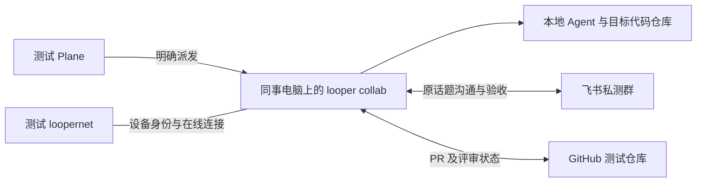

# 同事本地运行 Looper 协作端到端测试

本文面向运行本地 Agent 的研发同学。跑完后，应能在 Plane 派发一个任务，由 Agent 判断涉及哪些仓库，在飞书原话题沟通和验收，让原 Agent 继续修改同一个 PR，并观察 PR 最终结果。产品、设计和 QA 只需参与飞书沟通，不用安装本地服务。

**当前为联调指南，尚非已发布的一键安装流程。** Looper 使用 [PR #696](https://github.com/nexu-io/looper/pull/696) 的 `feat/looper-collab-standalone`；Plane 使用 [配套分支](https://code.powerformer.net/core/plane/src/branch/feat/looper-collab-standalone-main)（提交 `6733d80`），迁移为 `0157_looper_collaboration_dispatch`，接在最新 main 的 `0156` 之后。仅下载 main 或旧版 Looper 不够。任务无需绑定单一代码仓库，Agent 根据任务和本机可用仓库判断，必要时问人。早期联调工作树的 `0137` 是临时迁移，不能复制进最新 main 的数据库迁移链。本次实际结果和未修问题见[端到端测试记录](E2E-collab-2026-11-16.zh-CN.md)。

## 先理解要启动哪些东西



推荐复用维护者准备的测试 Plane 和 loopernet，同事只在自己的电脑启动 collab。无需 Friday、完整 `looperd`，也无需单独的 Planner／Reviewer／Fixer 进程。Agent 仍会在执行中自行评估影响面、按需规划。

loopernet 是设备连接基础设施，**当前 Plane 派发依赖它**；客户端随 collab 启动，不用同事另起本地客户端进程。纯终端派单可以不连接 Plane／loopernet，但那只能验证执行与飞书这一段。

## 1 准备测试环境和账号

维护者提供以下信息；同事不必了解内部签名协议：

| 信息 | 用途 |
|---|---|
| 配套 Looper／Plane 提交 | 确保双方都支持独立 collab 派发 |
| Plane 网页地址、API origin、测试 workspace／project | 网页给人打开；API origin 给 CLI 连接，分端口部署时两者不同 |
| loopernet 地址和一次性入网码 | 把本机加入同一测试网络；每台电脑独立设备身份 |
| 飞书测试应用、私测群 ID、本人 open_id | bot 已加入私测群，owner 是实际运行本地 Agent 的同学 |
| 允许修改的 sandbox GitHub 仓库 | 创建真实分支和 PR；需要测试账号具备读写权限 |

本地需要 Git、Go 1.22 或更新版本及 C 编译工具链（SQLite 使用 CGO）、已登录的 `gh`、可正常执行的 Codex 或团队 Agent、Node.js 20+、npm 和 `lark-cli`。当前独立入口在 macOS 验证，使用 Unix socket；不要据此认为 Windows 原生已经支持。

```sh
git --version
go version
gh auth status
codex --version
codex login status
lark-cli --version
lark-cli auth status --json --verify
```

未安装 `lark-cli` 时，可运行 `npm install -g @larksuite/cli`，按团队的飞书应用配置方式执行 `lark-cli config init`。适配器的消息读取、发送、图片及回复回执统一使用同一个应用的 bot 身份。bot 缺 scope 要在应用后台开通，重新做用户登录不能代替开通 bot 权限。

每个独立运行实例使用自己的测试 bot；同一 bot 只保留一个协作消息消费者，不要让多个同事的本机同时连接同一 bot。先使用“本人 + bot”的私测群；需要 QA 时先邀请、确认已经入群，再 @。所有协作消息、图片和文件以 **bot** 发送。测试自动邀请时，应用还需有建群、邀请成员权限且目标同学在应用可见范围内。本次现场先遇到权限与可用范围失败；开通发布后，产品自动建群与邀请片段已实测通过。人工加人仍不能冒充自动邀请验证。

## 2 编译并隔离本次运行

在包含配套修复的 Looper 工作树中执行。下面的变量和 shell 函数在同一个终端使用；换终端时重新设置。不要复制他人的 `.looper/network.json`、数据库或 Agent 登录凭证。

```sh
go build -o dist/looper ./cmd/looper

export COLLAB_ROOT="$PWD"
export COLLAB_BIN="$COLLAB_ROOT/dist/looper"
export COLLAB_CONFIG="$COLLAB_ROOT/.tmp/collab-e2e/config.json"
export COLLAB_STATE="$COLLAB_ROOT/.tmp/collab-e2e/state"
export COLLAB_REPO="$COLLAB_ROOT/.tmp/collab-e2e/sandbox"
export COLLAB_CODE_REPO='替换为允许测试的owner/repo'
export COLLAB_CHAT_ID='oc_替换为私测群ID'
export COLLAB_OWNER_ID='ou_替换为本人ID'

mkdir -p "$COLLAB_ROOT/.tmp/collab-e2e"
git clone "https://github.com/$COLLAB_CODE_REPO.git" "$COLLAB_REPO"

looper_test() { "$COLLAB_BIN" --config "$COLLAB_CONFIG" "$@"; }
looper_test collab --help
```

`--state-dir` 隔离协作数据库、socket 和日志，**不隔离设备身份**。设备身份仍来自本人 Looper home。已运行的完整 daemon 和 collab 不能同时用同一设备凭证发心跳；沿用已有实例时先协调停用，不要删除凭证绕开冲突。

## 3 生成最小配置

以下配置先不写 project，下一步 Plane 连接命令会生成 provider 和本地仓库映射，避免把同一 checkout 先注册成 GitHub 项目再绑定 Plane。

当前 `collab start` 直接运行固定版本的 feishu-codex-bridge，使用本机 Codex 的登录与 app-server；旧 Worker 的 `agent.params` 不控制该运行时。Agent 从中立的协作目录启动，通过仓库清单自行选择涉及的代码，按需创建 worktree。不要照搬现场的临时设备 ID、消息 ID 或密钥。

```sh
python3 - <<'PY'
import json, os, pathlib, shutil
root = pathlib.Path(os.environ['COLLAB_CONFIG']).parent
cfg = {
    'agent': {
        'vendor': 'codex',
        'nativeResume': {'enabled': True}
    },
    'hitl': {'enabled': True, 'answerTransport': 'feishu', 'feishu': {
        'chatId': os.environ['COLLAB_CHAT_ID'],
        'ownerOpenId': os.environ['COLLAB_OWNER_ID'],
        'cliPath': shutil.which('lark-cli') or 'lark-cli',
        'autoCreateTaskChats': False, 'inviteOpenIds': []
    }},
    'defaults': {'allowAutoCommit': True, 'allowAutoPush': True,
                 'allowAutoMerge': False, 'openPrStrategy': 'all_done'},
    'notifications': {'osascript': {'enabled': False}},
    'storage': {'mode': 'sqlite', 'dbPath': str(root / 'base.sqlite'),
                'backupDir': str(root / 'backups')},
    'daemon': {'logDir': str(root / 'logs'), 'shutdownTimeoutMs': 15000},
    'scheduler': {'maxConcurrentRuns': 1},
    'projects': []
}
path = pathlib.Path(os.environ['COLLAB_CONFIG'])
if path.exists():
    raise SystemExit('配置已存在；请编辑现有配置，不覆盖已有设备绑定。')
path.write_text(json.dumps(cfg, ensure_ascii=False, indent=2))
path.chmod(0o600)
PY

looper_test config validate
```

首轮设 `autoCreateTaskChats:false`，明确把任务送到这个私测群，方便先验证沟通。单独测试自动建群时改成 `true` 并重启空闲宿主；不要把固定群测试的通过写成自动建群已通过。角色配置不是前置要求；Agent 找不到对应产品／设计／QA 时可以问 owner。

## 4 加入网络并连接 Plane

从维护者提供的测试 loopernet 领取一次性入网码。`--no-enroll-projects` 避免把原有仓库全部改成 routed 模式；入网码不是管理员 token。

```sh
looper_test network join '替换为测试loopernet地址' \
  --key '替换为一次性入网码' --name '替换为唯一设备名' --no-enroll-projects
```

在 Plane 的个人 API key 页面为本人创建测试密钥，注入运行宿主的环境，默认名称为 `PLANE_API_KEY`。例如在当前终端隐式输入：

```sh
read -r -s PLANE_API_KEY
export PLANE_API_KEY
```

然后登录测试 Plane，在 item 的 Looper 面板点击“连接我的 Looper”，取得短期连接码。使用弹窗给出的 API 地址及连接码，显式保留 **`--collab`**，并传入本次配置和目标 checkout：

```sh
looper_test plane connect '替换为弹窗给出的Plane地址' \
  --code '替换为本次连接码' --collab \
  --project-path "$COLLAB_REPO" --code-repo "$COLLAB_CODE_REPO" \
  --plane-token-env PLANE_API_KEY
```

成功后会生成 provider、设备绑定和私钥，验证签名 inbox。不要手工填写 `bindingId`／`nodeId` 或复制同事私钥。连接码过期就从页面重新申请；报“已绑定另一台设备”时核查现有绑定，不反复重建。

如果 API 和网页不同端口，在生成的 `providers[]` 中为该 Plane provider 增加 `webBaseUrl`，值为**人能打开的网页 origin**。例如本地 API 是 `http://127.0.0.1:18040`、网页是 `http://localhost:3000` 时：

```json
{
  "baseUrl": "http://127.0.0.1:18040/api/v1",
  "webBaseUrl": "http://localhost:3000"
}
```

这里只修改这两个 URL 字段，保留该 provider 已生成的其他内容。不要把 API 端口链接当作任务网页；同事异机访问也不能用运行电脑的 localhost。

## 5 启动并确认可以接单

在启动终端中配置同一个飞书测试应用的 `FEISHU_APP_ID` 和 `FEISHU_APP_SECRET`。不要将 secret 写入配置、文档或 Git；后台启动会继承此环境。已有配置也可通过 `notifications.webhook.appIdEnv/appSecretEnv` 指定环境变量名。

首次启动会下载固定版本的上游源码并执行 npm 安装、构建，之后使用缓存；升级本分支后应在空闲时 stop/start 装载新代码。无需另开一个 bridge 服务。

新建群自动写入并置顶群公告，需要 bot 的 `im:chat.announcement:read`、`im:chat.announcement:write_only` 以及 `im:chat` 或 `im:chat.top_notice:write_only`。公告或可选邀请失败会记录日志，不因此拦住已经建好群的任务。

```sh
looper_test collab start --state-dir "$COLLAB_STATE"
looper_test collab status --state-dir "$COLLAB_STATE"
looper_test collab status --state-dir "$COLLAB_STATE" --json
```

预期看到 `looper collab · running` 和“设备在线”。正常情况下只启动一次，之后每个任务在 Plane 派发，不必重复运行 start。修改配置或环境变量后，在无执行中的时候停止、重启才会生效。

独立入口使用 `looper plane doctor --collab --state-dir "$COLLAB_STATE"`（按实际目录替换），检查协作宿主，不要求启动完整 `looperd` 或安装旧规划流程使用的 Plane CLI。未传 `--collab` 时仍检查旧 daemon 流程。诊断结果还要结合 Plane 本人设备在线和真实派发核对。

Plane 项目管理员在项目设置的 Looper 页面激活 collab 集成；无需强制填齐所有人的角色配置。item 里应能看到本人的在线设备。仓库是提供给 Agent 的上下文清单，不是必选派发字段；跨仓任务无需拆成多个话题或绑定仓库。配置缺失时补充仓库目录及用途，范围不清时由 Agent 问人。

## 6 创建任务并走完人工交接

在测试 project 创建一个小 item，例如“增加单文件中文验收页面”。任务描述可以使用下面的内容，并把验收人姓名替换为实际同学：

> 在任务描述明确允许的 sandbox 仓库增加一个无外部依赖的中文 HTML 页面，展示一个简单交互。先检查影响范围，再实现并验证。创建真实 PR，提供能让验收人直接查看的截图或可用预览，并说明交互体验方式。
>
> 请实际验收人在当前飞书话题验收；先邀请并确认入群，再 @。问题保持一两句，编号选项为“通过”“需要修改 + 原因”，技术验证放在折叠详情。消息和附件只用 bot 身份。回复后继续同一个任务和 PR；需要合并授权时再找有权同学。不要声称尚未发生的通过或合并。

分配给本人后，确认 item Looper 面板里的**本人设备**，再点派发／交给我的 Looper。仅创建 item 或分配负责人不代表已经启动。

依次验证：

1. 本机出现一个对应任务，Agent 在正确仓库的独立工作树执行；飞书出现一张有可点击 Plane 编号的主卡。
2. 状态更新原主卡，标签同字号、标题在右侧；问题在同一话题。工具过程及技术验证默认折叠，最终回复保留 Markdown。验收证据能由目标同学打开；外链失败时可尝试原生图片、文件或视频，并说明不能覆盖的交互。
3. 先在话题发一句普通人与人讨论，观察不要触发 Agent 的自动答复。随后**真实 @bot** 追问“为什么这样做”；bridge 收到定向回复后显示接收／执行回执，再由原会话解释，不能当作验收通过。消息走 bot 长连接，不再另跑 Worker 回复轮询。
4. @bot 给出一次明确修改要求，确认改的是原任务、原仓库、原 PR。不能重新开一个无关联任务。
5. 实际体验交付后，由验收人 @bot 回复结论。编号和自然语言都可以，不需要点击决策按钮。

当前提问卡默认显示问题、短选项、具体负责人；“判断依据与验证详情”可展开。图片应能在飞书直接查看。截图只能支持它展示的验收点，不能替代按钮或多步骤交互的实际体验。

## 7 跟进 PR 到真实结论

验收回复、Agent 输出结束或创建 PR 均不是任务终点。检查 Plane 和原飞书话题关联的是同一个真实 PR，由有权限的同学做正常 review；需要修改的评论应回到原 Agent，修复后更新同一个 PR。

配置中关闭了自动合并。按仓库规则完成实际评审和合并，再观察 Looper 是否记录真实结果。若 PR 关闭未合并，应记录未合并结果；不要假装成功。

有 CI 的测试仓库还应验证失败检查的处理；无 CI 就写“未配置 CI”。冲突、合并队列和异常退出要分别测试，不能从“一个 PR 创建成功”推断都已通过。遵循目标仓库自己的 GitHub／Odcrew 工具约定。

## 8 查看日志 停止与填写结果

```sh
looper_test collab logs --state-dir "$COLLAB_STATE"
looper_test collab stop --state-dir "$COLLAB_STATE"
```

协作日志位于 `$COLLAB_STATE/collab.log`，数据库为 `$COLLAB_STATE/looper.sqlite`，任务执行日志在 `$COLLAB_STATE/logs/` 下。当前 logs 命令显示宿主日志末段，还不是按任务浏览完整执行的产品入口。

正常停止后，可用同一配置和同一 state-dir 再启动，核对原任务和待答问题保留。先测无执行中／等待人时的重启。本次曾出现执行中停止排空失败、恢复隔离，尚未修完；遇到 `uncertain`、`no PID Authority` 或 `SIGTERM: operation not permitted`，保留日志找维护者，不手改数据库或按历史 PID 杀进程。

把结果补到自己的测试记录，至少写：代码版本、Plane item、实际仓库、PR、飞书话题、测试步骤、预期／实际、证据可访问性、人工补位、哪些项目尚未覆盖。只有真实完成的步骤写通过。共享记录不要包含 API key、cookie、Agent 凭证或设备私钥。

| 现象 | 先看哪里 |
|---|---|
| collab 子命令不存在 | 是否用了本次构建的 `dist/looper`，而非系统旧版 |
| 运行中但 Plane 设备离线 | loopernet 地址、本人节点绑定、心跳身份、是否另一宿主占用设备 |
| 派发没有开工 | 项目 collab 激活、本人绑定、目标仓库匹配、签名 inbox 错误和宿主日志 |
| 链接打开 Django 404 | `webBaseUrl` 是否错指 API 地址 |
| 建群／邀请返回权限错误 | bot scope、应用可见范围、群内权限；不切换成 user 发消息 |
| @bot 没继续 | 是否在正确话题真实 @、任务是否正在等待人、读取话题权限与日志 |
| 日志提示启动 daemon | 是否误用了旧 connect／doctor 流程；独立连接必须带 `--collab` |

## 人员目录

协作入口启动后自动读取当前 bot 可见的飞书通讯录和已连接的 Plane 项目成员，每 10 分钟刷新到 `<state-dir>/workspace/people.json`。Agent 的工作指引已包含这个位置；需要找人时读取，不需要为每项任务维护角色配置。

也可以查看当前快照：

```sh
dist/looper collab people --config "$COLLAB_CONFIG" --state-dir "$COLLAB_STATE" --json
```

`feishu.users` 保存姓名、当前应用的 open_id，以及上游允许读取的其他基础字段；`plane` 按 connection 列出成员。没有姓名／字段权限、不可见的人员或同步失败会显示 `error`。每次刷新替换快照，不将旧成员静默保留为当前人员。文件仅本机用户可读，不入库、不贴到群里；它不含登录凭证，也不采集手机号或邮箱。

应用需要 `contact:contact.base:readonly` 读取通讯录，另需 `contact:user.base:readonly` 读取姓名；按需开启 `contact:user.employee:readonly` 后才能取得任职状态等字段。字段不存在表示未知，不能当成“已确认在职”。应用通讯录数据范围建议按需要覆盖团队所在部门或全员，使新员工进入该范围后自动出现。仅配置若干个人不会自动覆盖后续新员工。当前支持可见部门（含子部门）和直接授权用户；只有用户组授权时会标记目录不完整，不能声称已同步全部人员。

飞书 `open_id` 属于具体应用，CLI 应用与 bridge 应用不一致时会报告错误，不提供错误应用的人员 ID，但不阻塞任务执行。人员目录同步在后台运行，不阻塞派单、消息回执或 PR 跟进。

当前按已确认方案**同步两份真实目录，不按邮箱／同名自动合并账号**。Agent 根据任务和对话查阅找人，不确定就问 owner；明确人选后仍需先邀请、确认入群，再 @。公司 SSO 保存飞书身份不代表当前 Plane 已暴露对应字段，本次不扩展 SSO 或 Plane 登录流程。

验收时检查：目录中能按姓名找到已授权同事；在测试来源新增／移除成员后下一轮快照对应变化；禁用权限时出现错误而非旧数据冒充成功；普通任务不因目录缺失被拦住。真实邀请与 @ 沿用第 6 节，在已授权私测群验证，不向大群广播。

## 附录 在自己电脑启动 Plane

已有可用测试 Plane 时跳过本节。要本地验证 Plane 改动，取得 `https://code.powerformer.net/core/plane` 的配套分支 `feat/looper-collab-standalone-main`，按该仓库的 `AGENTS.md` 和 `apps/api/LOCAL_DEVELOPMENT.md` 准备环境。该分支基于最新 main，collab migration 接在 `0156` 之后，不使用早期工作树的 `0137` 临时迁移。优先原生 Django／Web，不启动完整 Compose。

在 Plane 工作树内：

```sh
./setup.sh
```

该脚本安装工作区及 Python 依赖并生成环境文件，仅首次空白环境运行；已有 `.env` 不要用它覆盖。准备一个隔离 PostgreSQL 数据库，在 `apps/api/.env` 中填写 `DATABASE_URL`，并配置：

```dotenv
PLANE_API_BIND=127.0.0.1:18040
WEB_URL=http://localhost:3000
APP_BASE_URL=http://localhost:3000
LOCAL_STORAGE_BASE_URL=http://127.0.0.1:18040
CORS_ALLOWED_ORIGINS=http://localhost:3000
CSRF_TRUSTED_ORIGINS=http://localhost:3000,http://127.0.0.1:18040
LOOPERNET_BASE_URL=替换为测试网络地址
LOOPERNET_NETWORK_ID=替换为同一测试网络ID
LOOPERNET_SERVICE_CREDENTIAL_FILE=替换为本机目录服务凭证文件绝对路径
LOOPERNET_TRUST_ROOTS_FILE=替换为本机测试网络公钥信任文件绝对路径
```

loopernet 的目录凭证和 trust roots 由测试环境维护者提供并配成同一网络，凭证文件权限为 `0600`。目录凭证不是管理员 token，也不是 Plane API key。若要自建 loopernet，参考 [loopernet 部署说明](loopernet-deployment.md)，同时配置挑战签名私钥 `LOOPERNET_TRUST_PRIVATE_KEY_FILE` 和 `LOOPERNET_TRUST_KEY_REVISION`，将匹配的公钥信任配置交给 Plane；只启动一个能响应 health 的服务还不足以完成设备绑定。

两个终端分别运行：

```sh
pnpm --filter plane-api dev
```

```sh
pnpm build:packages
VITE_API_BASE_URL=http://127.0.0.1:18040 pnpm --filter web dev
```

API 启动入口会执行迁移和本地 instance 初始化。空白环境还需完成 instance 管理员初始化、登录、创建 workspace／project，以及本人 API key；不复制本次现场的测试账号／cookie，不通过改数据库状态代替正常初始化。若页面引导去管理员应用，启动 `pnpm --filter admin dev`，按页面完成设置。

浏览器打开 `http://localhost:3000`，后续回到本文第 4 步。给 CLI 的连接 origin 使用弹窗实际地址，本地直连通常为 `http://127.0.0.1:18040`；`webBaseUrl` 则为 `http://localhost:3000`。本地登录不算公司 SSO 验证，localhost 也不能拿来给异机验收人使用。
